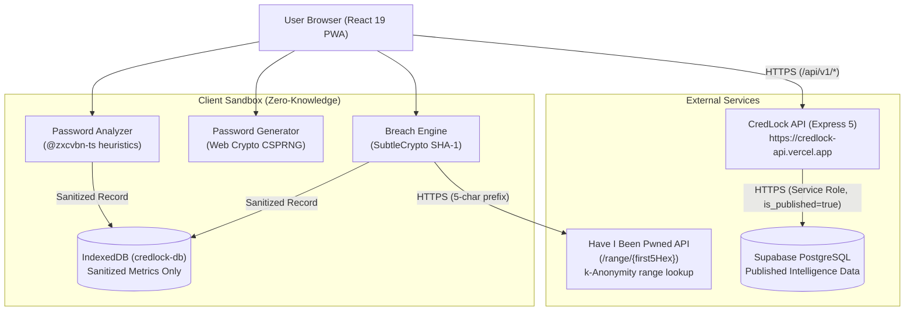

# CredLock

**A Zero-Knowledge Progressive Web Application for Password Security & Threat Intelligence.**

[](https://www.typescriptlang.org/)
[](https://react.dev/)
[](https://expressjs.com/)
[](https://vitejs.dev/)
[](https://supabase.com/)
[](#10-automated-testing--verification)

CredLock is a privacy-first cybersecurity Progressive Web Application (PWA) designed to empower users to analyze password strength, generate cryptographically sound credentials, detect data breach exposures, and review verified security intelligence.

CredLock strictly separates client-side credential processing from remote telemetry, enforcing a **Zero-Knowledge Invariant** where sensitive credentials never traverse network sockets or persist in unencrypted storage.

---

## 1. Project Status & Live Production Endpoints

CredLock development and production deployments are complete and verified:

- **Live Backend API (Production):** [`https://credlock-api.vercel.app`](https://credlock-api.vercel.app)
- **API Liveness Probe:** [`https://credlock-api.vercel.app/api/health`](https://credlock-api.vercel.app/api/health)
- **API Database Readiness Probe:** [`https://credlock-api.vercel.app/api/health/db`](https://credlock-api.vercel.app/api/health/db)
- **Frontend PWA:** Deployed on Vercel (configured with `VITE_CREDLOCK_API_URL=https://credlock-api.vercel.app`)
- **Automated Verification:** **297 / 297 automated tests passed** (179 frontend tests, 118 backend tests).
- **TypeScript & Linting:** 0 compiler errors across both frontend and backend projects.

---

## 2. Core Implemented Features

### 🛡️ 1. Password Strength Analyzer
- **Local In-Memory Evaluation**: Evaluates passwords entirely within the browser client; zero network transmission.
- **Advanced Heuristic Scoring**: Powered by `@zxcvbn-ts/core`, detecting dictionary words, spatial keyboard walks, l33t speak, sequences, and repeated patterns.
- **Multi-Scenario Crack Time Modeling**: Estimates crack resistance across four threat models: Online Throttled (100/hour), Online Unthrottled (10/sec), Offline Slow Hash (10,000/sec), and Offline Fast Hash (10,000,000,000/sec).
- **Theoretical Pool Entropy & Crack Difficulty**: Clearly separates theoretical character-pool entropy ($L \times \log_2(R)$) from empirical guess difficulty ($\log_2(\text{guesses})$).

### 🔑 2. Secure Password Generator
- **Web Crypto CSPRNG**: Exclusively utilizes `window.crypto.getRandomValues()`; strictly disallows insecure pseudo-random generators (`Math.random()`).
- **Unbiased Rejection Sampling**: Implements integer rejection sampling to eliminate modulo bias across non-power-of-two pool sizes.
- **Candidate-Level Category Constraints**: Guarantees inclusion of required character sets (lowercase, uppercase, numbers, symbols) via candidate-level rejection sampling, preserving a mathematically uniform distribution over the valid space.
- **Zero Transient Persistence**: Generated passwords exist only in active component memory, never written to disk, history, or telemetry.

### 🔍 3. Password Breach Checker (k-Anonymity)
- **Client-Side SHA-1 Hashing**: Computes cryptographic digest using Web Crypto `crypto.subtle.digest('SHA-1', ...)`.
- **k-Anonymity Mathematical Model**: Transmits only the first 5 hexadecimal characters of the hash to the Have I Been Pwned (HIBP) range API (`https://api.pwnedpasswords.com/range/{prefix}`).
- **Local Hash Suffix Verification**: Compares the remaining 35 characters of the hash locally in client memory; raw passwords and full hashes never leave the device.

### 📊 4. Security Intelligence REST API & Catalog
- **Live Threat Telemetry Dashboard**: Real-time aggregated statistics covering total breaches, compromised accounts, and severity distributions.
- **Breach Intelligence Catalog**: Searchable and paginated directory of verified cybersecurity incidents in Indonesia and globally, with detailed timelines, exposed data classes, and source citations.
- **Security Hardening Guidance**: Actionable remediation recommendations and step-by-step playbooks categorized by authentication, password policies, devices, and networks.
- **Cybersecurity Research Advisories**: In-depth educational articles covering k-anonymity mathematics, password entropy theory, and multi-factor authentication architectures.

### 💾 5. Sanitized History & Persistence
- **IndexedDB Storage (`credlock-db`)**: Client-side persistent audit logging.
- **Strict Sanitization Invariant**: Records only structural metadata (record UUID, timestamp, score, length, theoretical entropy, and breach occurrence count). Passwords, full hashes, and hash prefixes/suffixes are strictly excluded.
- **Complete User Ownership**: Provides single-record deletion and complete history purge capabilities.

### 🎨 6. Obsidian Vault UI & Adaptive Navigation
- **Design Identity**: Industrial warm-charcoal surfaces (`#0C0D0E`, `#131517`), Safety Amber accents (`#E5A93C`), and hairline architectural borders.
- **Adaptive Capsule Navigation**: Dynamic navigation bar that smoothly contracts into a compact capsule during scrolling and resets upon route navigation.
- **Full Responsive Optimization**: Fluid layout scaling from mobile viewports (360px) to wide desktop displays (1440px+).

---

## 3. Recommended Screenshots & UI Previews

*Note: In accordance with repository audit standards, screenshot image assets are not fabricated. The following views represent the core interfaces of the application:*

| View | Route | Description |
|---|---|---|
| **Security Dashboard** | `/` | Aggregated threat intelligence KPIs, quick tool launchers, recent incidents, and security posture summary. |
| **Password Analyzer** | `/analyzer` | Real-time score meter, composition badges, crack-time threat matrix, pattern feedback, and sanitized save button. |
| **Secure Generator** | `/generator` | Monospace password display, length slider (8–64), category toggles, theoretical pool entropy badge, and copy action. |
| **Breach Checker** | `/breach-checker` | k-Anonymity range checker with SHA-1 prefix visualization and exposure status readout. |
| **Breach Intelligence** | `/breaches` | Paginated incident catalog with search, severity filter chips, and comprehensive detail pages (`/breaches/:slug`). |
| **Recommendations** | `/recommendations` | Hardening guidance cards with category filters and step-by-step implementation playbooks. |
| **Articles & Advisories**| `/articles` | Cybersecurity research articles with reading time and full Markdown advisory reader. |
| **Sanitized History** | `/analysis-history` | Local audit log displaying sanitized password metrics with zero credential exposure. |

---

## 4. Technology Stack

Verified directly from repository configuration:

### Frontend (Client-Side PWA)
- **Framework:** React 19.0.0
- **Language:** TypeScript 5.7.2
- **Build Tool:** Vite 6.0.3
- **Routing:** React Router 7.1.0
- **Styling:** Tailwind CSS 3.4.17, PostCSS 8.4, Autoprefixer 10.4
- **Heuristics & Password Analysis:** `@zxcvbn-ts/core` (v4.2.0), `@zxcvbn-ts/language-common` (v4.1.3), `@zxcvbn-ts/language-en` (v4.1.1)
- **Cryptography:** Web Crypto API (`crypto.getRandomValues`, `crypto.subtle.digest`)
- **Icons:** Lucide React 0.468.0
- **Client Persistence:** IndexedDB (via native transactional wrapper `db.ts`)
- **Testing:** Node.js native test runner (`node:test`) with TypeScript type stripping

### Backend (Security Intelligence API)
- **Runtime:** Node.js 20+ (tested on Node 22)
- **Framework:** Express 5.0.1
- **Language:** TypeScript 5.7.2 (NodeNext module resolution, ESM native)
- **Database:** Supabase Managed PostgreSQL via `@supabase/supabase-js` (v2.119.2)
- **Schema Validation:** Zod 3.24.2
- **Security Middleware:** `helmet` 8.3.0, `cors` 2.8.5, `express-rate-limit` 7.5.0
- **Testing:** Vitest 3.0.5, Supertest 7.0.0
- **Development Tooling:** `tsx` 4.19.2

---

## 5. System Architecture



For complete technical diagrams and module specifications, see:
- [System Architecture Specification](docs/ARCHITECTURE.md)
- [Security & Threat Model Documentation](docs/SECURITY.md)
- [REST API Reference](docs/API.md)
- [Production Deployment Guide](docs/DEPLOYMENT.md)

---

## 6. Project Directory Structure

```text
CredLock/
├── .env.example                     # Frontend environment template
├── package.json                     # Frontend dependencies & npm scripts
├── tsconfig.json                    # Frontend TypeScript configuration
├── vite.config.ts                   # Vite bundler & vendor chunking rules
├── public/                          # Static web assets (favicon, manifest)
├── docs/                            # In-depth technical documentation
│   ├── ARCHITECTURE.md              # System architecture & topology
│   ├── DEPLOYMENT.md                # Vercel & Supabase production deployment
│   ├── SECURITY.md                  # Security controls, entropy & threat models
│   └── API.md                       # Complete REST API reference
├── src/                             # Frontend application source
│   ├── app/                         # App root, routing & layout wrappers
│   ├── components/                  # Design system UI & layout components
│   ├── context/                     # UI contexts (ToastContext)
│   ├── hooks/                       # Custom React hooks (useHistory, useOnlineStatus)
│   ├── pages/                       # Application route page components
│   ├── services/                    # Client services & API integration
│   │   ├── api/                     # Centralized API client & feature services
│   │   ├── breachChecker.ts         # k-Anonymity SHA-1 engine
│   │   ├── passwordAnalyzer.ts      # zxcvbn password heuristics wrapper
│   │   ├── passwordGenerator.ts     # Web Crypto CSPRNG generator engine
│   │   └── historyStorage.ts        # Sanitized audit storage operations
│   ├── styles/                      # Tailwind CSS root styles
│   └── types/                       # Shared TypeScript interfaces
├── tests/                           # Frontend automated test suites (70 suites)
│
└── backend/credlock-api/            # Express.js + TypeScript Backend Service
    ├── .env.example                 # Backend environment variable template
    ├── package.json                 # Backend dependencies & npm scripts
    ├── tsconfig.json                # TypeScript NodeNext ESM configuration
    ├── vercel.json                  # Vercel serverless rewrite configuration
    ├── api/                         # Vercel serverless function entry point
    │   └── index.ts                 # Express serverless handler
    ├── database/                    # SQL migrations, seeds & database docs
    ├── src/                         # Backend source code
    │   ├── app.ts                   # Express app setup & middleware stack
    │   ├── server.ts                # Local HTTP listener (port 4000)
    │   ├── config/                  # Environment validation & Supabase client
    │   ├── controllers/             # Request handlers (Dashboard, Breaches, Recs, Articles)
    │   ├── middleware/              # Helmet, CORS, Rate Limit, Error handlers
    │   ├── repositories/            # Database queries with published-only filters
    │   ├── routes/                  # Express route definitions (/api/health, /api/v1/*)
    │   ├── services/                # Business logic & telemetry aggregators
    │   ├── types/                   # Backend DTOs & data models
    │   └── validators/              # Zod schema validators
    └── tests/                       # Backend test suites (9 test files)
```

---

## 7. Installation & Local Development Setup

### Prerequisites
- **Node.js**: v18.0.0 or higher (v20 / v22 recommended)
- **npm**: v9.0.0 or higher
- **Git**

### Step 1: Clone Repository
```bash
git clone https://github.com/whosArlend/CredLock.git
cd CredLock
```

### Step 2: Setup Frontend
```bash
# Install frontend dependencies
npm install

# Configure environment variables
cp .env.example .env
```
*(The default `.env` points `VITE_CREDLOCK_API_URL` to `http://localhost:4000`)*.

Start the frontend development server:
```bash
npm run dev
```
The application will be accessible at: `http://localhost:5173`.

### Step 3: Setup Backend API (Optional for Offline / Mock Use)
In a separate terminal:
```bash
cd backend/credlock-api

# Install backend dependencies
npm install

# Configure backend environment variables
cp .env.example .env
```
Configure your Supabase credentials in `backend/credlock-api/.env`:
```env
NODE_ENV=development
PORT=4000
FRONTEND_URL=http://localhost:5173
SUPABASE_URL=https://your-project.supabase.co
SUPABASE_SECRET_KEY=your-supabase-secret-key-here
```

Start the backend server:
```bash
npm run dev
```
The API server will be accessible at: `http://localhost:4000`.

---

## 8. Environment Variables

### Frontend (`.env`)
| Variable | Required | Default | Purpose |
|---|:---:|---|---|
| `VITE_CREDLOCK_API_URL` | **Yes** | `http://localhost:4000` | Base URL of the Security Intelligence API. In production, set to `https://credlock-api.vercel.app`. |
| `VITE_APP_ENV` | Optional | `development` | Active application environment. |

### Backend (`backend/credlock-api/.env`)
| Variable | Required | Default | Purpose |
|---|:---:|---|---|
| `NODE_ENV` | Optional | `development` | Runtime mode (`development`, `production`, `test`). |
| `PORT` | Optional | `4000` | Port for local HTTP listener. |
| `FRONTEND_URL` | **Yes** (Prod) | `http://localhost:5173` | Allowed CORS origin(s). Supports comma-separated list. |
| `SUPABASE_URL` | **Yes** (DB) | - | Supabase project URL endpoint. |
| `SUPABASE_SECRET_KEY` | **Yes** (DB) | - | Privileged service role secret key. Bypasses RLS safely via hardcoded repository filters. |

> [!WARNING]
> `SUPABASE_SECRET_KEY` must **NEVER** be committed to Git, published in documentation, or exposed to the frontend PWA.

---

## 9. Build Commands

### Frontend Production Build
```bash
# Type-check and compile Vite production bundle to dist/
npm run build

# Preview compiled production build locally
npm run preview
```

### Backend Production Build
```bash
# Compile TypeScript to dist/ using tsconfig.json (NodeNext ESM)
npm run build --prefix backend/credlock-api

# Start production server from dist/
npm start --prefix backend/credlock-api
```

---

## 10. Automated Testing & Verification

CredLock enforces a strict test-driven quality standard with **297 automated tests**:

```bash
# Run all frontend tests (70 suites, 179 tests)
npm test

# Run all backend tests (9 suites, 118 tests)
npm test --prefix backend/credlock-api

# Run TypeScript typechecks
npm run typecheck --prefix backend/credlock-api
npx tsc -b
```

### Test Suite Summary:
- **Frontend (179 tests, 70 suites)**:
  - Cryptographic CSPRNG uniform sampling & Fisher-Yates shuffle integrity.
  - Candidate rejection sampling and category boundary enforcement.
  - zxcvbn password heuristics, crack time calculations, and theoretical entropy.
  - k-Anonymity SHA-1 prefix partitioning and padding handling.
  - IndexedDB storage transactions, record sanitization, and purge operations.
  - Adaptive capsule navigation scroll threshold state machines.
  - Centralized API client error mapping, URL normalization, and timeouts.
- **Backend (118 tests, 9 suites)**:
  - API liveness and database readiness probes (`/api/health`, `/api/health/db`).
  - Threat telemetry aggregation and severity distribution calculations.
  - Paginated list queries, substring search, and field sorting across all models.
  - Slug-based detail endpoints with 404 handling.
  - Helmet security headers and CORS origin reflection.
  - Rate limiting enforcement (100 req/15 min).
  - Vercel serverless function export compatibility.
  - Repository visibility invariants (`is_published = true`, `is_verified = true`).

---

## 11. Production Deployment on Vercel

CredLock is deployed as two decoupled services on Vercel:

1. **Backend Serverless API (`credlock-api`)**:
   - Repository sub-root: `backend/credlock-api`
   - Build Command: `npm run build`
   - Install Command: `npm install --include=dev`
   - Production URL: `https://credlock-api.vercel.app`
2. **Frontend Client Application (`credlock`)**:
   - Repository root: `./`
   - Build Command: `npm run build`
   - Output Directory: `dist`
   - Environment Variable: `VITE_CREDLOCK_API_URL=https://credlock-api.vercel.app`

For detailed step-by-step instructions and redeployment procedures, consult [Production Deployment Guide](docs/DEPLOYMENT.md).

---

## 12. Security Architecture & Limitations

### Implemented Controls
- **Zero Plaintext Transmission**: Client passwords never leave browser memory.
- **k-Anonymity Model**: HIBP queries expose only 20 bits (5 hexadecimal characters) of the SHA-1 hash.
- **CSPRNG Generation**: Eliminates modulo bias and preserves uniform category distribution.
- **Sanitized Audit Records**: Local history stores only structural metadata.
- **Defensive API Stack**: Helmet security headers, CORS origin whitelisting, rate limiting (100 req/15 min), and 100kb body size limits.

### Boundaries & Limitations
- **Client Endpoint Integrity**: Keystroke loggers, rogue browser extensions, or compromised operating systems bypass in-browser cryptographic protections.
- **Clipboard Accessibility**: Copying a generated password places it in the operating system clipboard, where other desktop applications may read it.
- **Heuristic Scope**: Password strength models estimate search spaces based on known dictionary and spatial heuristics; they cannot detect passwords composed of private personal information unknown to the dictionaries.

---

## 13. Academic Information

- **Project Title:** *CredLock: A Zero-Knowledge Progressive Web Application for Password Security, Cryptographic Generation, and Breach Intelligence.*
- **Platform:** Progressive Web Application (PWA) + RESTful Microservice
- **Author:** Alif Arlendi
- **Department:** Computer Engineering
- **Status:** Completed & Production Deployed (November 2026)

---

## 14. License & Usage

All rights reserved. Developed as an academic capstone project in Computer Engineering. Commercial use, reproduction, or distribution without explicit permission is prohibited. For research inquiries or educational access, please contact the repository owner.
