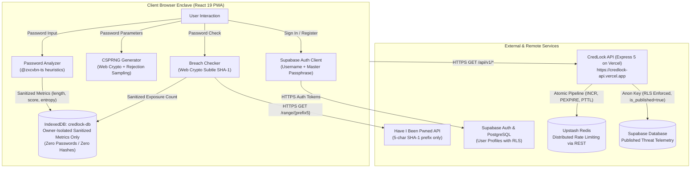

# CredLock

**Client-Side Password Security & Privacy Environment**

[](CHANGELOG.md)
[](https://www.typescriptlang.org/)
[](https://react.dev/)
[](https://expressjs.com/)
[](https://vitejs.dev/)
[](https://supabase.com/)
[](https://upstash.com/)
[](#10-automated-testing--verification)

CredLock is a privacy-first, client-side cybersecurity Progressive Web Application (PWA) designed for high-assurance password strength analysis, cryptographically uniform credential generation, k-Anonymity breach detection, and verified threat intelligence.

CredLock strictly separates local client-side credential processing from remote telemetry, enforcing a **Zero-Knowledge Invariant**: sensitive credentials never traverse network sockets, leave volatile component memory, or persist unencrypted in remote cloud databases.

---

## 1. Project Status & Live Production Endpoints

CredLock v2.1.0 is successfully deployed and production-verified:

- **Current Release:** **CredLock v2.1.0** — consult [CHANGELOG.md](CHANGELOG.md) for full release history.
- **Frontend PWA:** Deployed on Vercel
- **Live Backend API (Production):** [`https://credlock-api.vercel.app`](https://credlock-api.vercel.app)
- **API Liveness Probe:** [`https://credlock-api.vercel.app/api/health`](https://credlock-api.vercel.app/api/health)
- **API Database Readiness Probe:** [`https://credlock-api.vercel.app/api/health/db`](https://credlock-api.vercel.app/api/health/db)
- **Automated Verification:** **466 / 466 automated tests passed** (280 frontend tests, 186 backend tests).
- **TypeScript & Linting:** 0 compiler errors, 0 ESLint warnings across both frontend and backend codebases.

---

## 2. Core Capabilities

### 🛡️ 01 — Multi-Method Password Strength Analyzer
- **Local In-Memory Evaluation**: Evaluates passwords entirely within the browser client; zero network transmission.
- **Selectable Analysis Workbenches**:
  1. **Zxcvbn Analysis (Baseline)**: Pattern-aware dictionary matching, spatial keyboard walks, sequential runs, repeat characters, and l33t speak substitutions with 4 threat crack-time scenarios.
  2. **Keyspace Entropy Analysis**: Computes theoretical Shannon-style keyspace entropy ($H = L \times \log_2(R)$) with explicit disclosures regarding uniform-randomness assumptions.
  3. **Markov Chain Sequence Analysis (Experimental)**: 1st-order probabilistic character transition model computing surprisal ($S = -\log_2 P$), average surprisal ($\overline{S} = S / L$), sequence perplexity ($2^{\overline{S}}$), and predictability index (0–100) using a transparent heuristic digraph/walk baseline model with Laplace smoothing floor ($10^{-4}$).
  4. **Compare All Methods**: Simultaneous side-by-side execution with automatic divergence synthesis explaining discrepancies (e.g. why `Password123!` has high keyspace entropy but poor dictionary & Markov resistance).

### 🔑 02 — Cryptographically Secure Generator
- **Web Crypto CSPRNG**: Exclusively utilizes `window.crypto.getRandomValues()`; strictly prohibits insecure pseudo-random fallback (`Math.random()`).
- **Unbiased Rejection Sampling**: Implements integer rejection sampling over 32-bit unsigned integers to eliminate modulo bias across non-power-of-two pool sizes.
- **Uniform Category Distribution**: Enforces category constraints (lowercase, uppercase, numbers, symbols) via candidate-level rejection sampling, preserving a mathematically uniform distribution over the valid space without positional permutation bias.
- **Transient Memory Scoping**: Generated credentials exist solely in active component memory and are never written to disk or telemetry.

### 🔍 03 — Password Breach Verification (k-Anonymity)
- **Client-Side Digest Computation**: Computes SHA-1 hash client-side using Web Crypto `crypto.subtle.digest('SHA-1', ...)`.
- **k-Anonymity Mathematical Model**: Transmits only the first 5 hexadecimal characters (20 bits) of the hash to the Have I Been Pwned (HIBP) range API (`https://api.pwnedpasswords.com/range/{prefix}`).
- **Local Hash Suffix Matching**: Compares the remaining 35 characters locally in volatile client memory; raw passwords and full hashes never leave the device.

### 💾 04 — Sanitized Local History & Owner Isolation
- **Browser-Local IndexedDB (`credlock-db`)**: Persistent client-side audit ledger with zero remote cloud persistence.
- **Strict Sanitization Invariant**: Persists solely non-sensitive structural metrics (record UUID, timestamp, score, length, theoretical entropy, crack time string, and breach exposure count). Passwords, full hashes, prefixes, and suffixes are strictly excluded.
- **Owner Scope Partitioning**: Local records are strictly partitioned by authenticated user ID (`owner_id`) or `guest`. Users on a shared browser cannot view other accounts' audit logs.
- **Privacy Scope Indicators & Notices**: Explicit badges (`Scope: @username` or `Scope: Guest Session`) and shared-device privacy warnings.
- **Data Sovereignty Controls**: Single-record deletion and complete local data wiping without affecting active authentication sessions.

### 📊 05 — Security Intelligence REST API & Catalog
- **Aggregated Threat Telemetry**: Real-time KPIs covering total breaches, compromised accounts, and severity distributions.
- **Breach Incident Catalog**: Searchable and paginated directory of verified cybersecurity incidents with affected data classes and source citations.
- **Security Hardening Guidance**: Actionable remediation recommendations and step-by-step implementation playbooks.
- **Research Advisories**: Peer-reviewed educational articles covering password entropy, k-anonymity mathematics, and MFA architectures.

---

## 3. Security & Privacy Architecture



### Privacy Model Boundaries:
1. **Client-Side Password Analysis**: Passwords entered into Analyzer or Breach Checker are **never** transmitted to CredLock's backend, logged, or sent to analytics.
2. **k-Anonymity Remote Lookup**: Only a 5-character prefix of the SHA-1 hash is sent to the public HIBP range endpoint. The external service cannot deduce the original password from this 20-bit prefix.
3. **Local Audit History**: Audit records are stored **strictly on the user's device** in IndexedDB (`credlock-db`). CredLock has no remote history database.
4. **Authentication Enclave**: Authentication is powered by Supabase Auth using a **Username + Master Passphrase** scheme (no email or phone numbers required). User sessions are maintained locally via secure token storage.
5. **No Active Cloud Sync**: In CredLock v2.0.0, audit records remain strictly local to the browser. Cross-device cloud history sync is a **future research roadmap item** and is not currently active.

---

## 4. Technology Stack

Verified directly from repository configuration:

### Frontend (Client-Side PWA)
- **Framework:** React 19.0.0
- **Language:** TypeScript 5.7.2
- **Build Tool:** Vite 6.0.3
- **Routing:** React Router 7.1.0
- **Styling:** Tailwind CSS 3.4.17, PostCSS 8.4, Autoprefixer 10.4
- **Heuristics & Password Analysis:** `@zxcvbn-ts/core` (v4.2.0), `@zxcvbn-ts/language-common` (v4.1.3), `@zxcvbn-ts/language-en` (v4.1.1)
- **Cryptography:** Web Crypto API (`window.crypto.getRandomValues`, `crypto.subtle.digest`)
- **Authentication Client:** `@supabase/supabase-js` (v2.119.2)
- **Client Persistence:** IndexedDB (via custom transactional wrapper `db.ts`)
- **Icons:** Lucide React 0.468.0
- **Testing:** Node.js native test runner (`node:test`) with experimental type stripping

### Backend (Security Intelligence API)
- **Runtime:** Node.js 20+ (tested on Node 22)
- **Framework:** Express 5.0.1
- **Language:** TypeScript 5.7.2 (NodeNext module resolution, ESM native)
- **Database Client:** Supabase JavaScript Client (`@supabase/supabase-js` v2.119.2) with Least-Privilege Anonymous Key
- **Distributed Rate Limiting:** Upstash Redis over REST pipeline API via native `fetch` (zero external dependencies)
- **Schema Validation:** Zod 3.24.2
- **Security Middleware:** `helmet` 8.3.0, `cors` 2.8.5, `express-rate-limit` 7.5.0
- **Testing:** Vitest 3.0.5, Supertest 7.0.0
- **Development Tooling:** `tsx` 4.19.2

---

## 5. Repository Directory Overview

```text
CredLock/
├── .env.example                     # Frontend environment variable template
├── package.json                     # Frontend dependencies & npm scripts (v2.0.0)
├── tsconfig.json                    # Frontend TypeScript configuration
├── vite.config.ts                   # Vite bundler & vendor chunking rules
├── index.html                       # HTML application entry point
├── CHANGELOG.md                     # Version release history
├── public/                          # Static public web assets
│   ├── favicon.svg                  # Dark-mode SVG favicon
│   ├── favicon-white.svg            # Light-mode SVG favicon
│   └── manifest.json                # PWA web app manifest (v2.0.0)
├── docs/                            # In-depth technical documentation
│   ├── ARCHITECTURE.md              # System architecture & topology
│   ├── DEPLOYMENT.md                # Vercel & Supabase production deployment
│   ├── SECURITY.md                  # Security controls & threat models
│   └── API.md                       # Complete REST API reference
├── src/                             # Frontend application source
│   ├── app/                         # App routing & root providers
│   ├── components/                  # UI design system & layout components
│   │   ├── auth/                    # Auth forms & session modals
│   │   ├── layout/                  # Navigation bar, header, containers
│   │   └── ui/                      # Buttons, badges, modals, tooltips
│   ├── constants/                   # Centralized application constants (version.ts)
│   ├── context/                     # AuthContext & ToastContext
│   ├── features/                    # Feature modules (analyzer, breach, generator, home)
│   ├── hooks/                       # Custom React hooks (useAuth, useHistory, useScroll)
│   ├── pages/                       # Route view components (18 pages)
│   ├── services/                    # Crypto, storage, and API integration
│   │   ├── api/                     # Centralized API client & feature services
│   │   ├── breachChecker.ts         # k-Anonymity SHA-1 engine
│   │   ├── passwordAnalyzer.ts      # zxcvbn password heuristics wrapper
│   │   ├── passwordGenerator.ts     # Web Crypto CSPRNG generator engine
│   │   └── historyStorage.ts        # Owner-scoped IndexedDB persistence
│   ├── styles/                      # Tailwind CSS root stylesheet
│   └── types/                       # Shared TypeScript interfaces
├── tests/                           # Frontend automated test suites (12 test suites, 262 tests)
│
└── backend/credlock-api/            # Express.js + TypeScript Backend Service
    ├── .env.example                 # Backend environment variable template
    ├── package.json                 # Backend dependencies & npm scripts (v2.0.0)
    ├── tsconfig.json                # TypeScript NodeNext ESM configuration
    ├── vercel.json                  # Vercel serverless rewrite configuration
    ├── api/                         # Vercel serverless function entry point
    │   └── index.ts                 # Express serverless handler
    ├── database/                    # SQL schema, RLS policies, migrations & seeds
    ├── src/                         # Backend source code
    │   ├── app.ts                   # Express app setup & middleware stack
    │   ├── server.ts                # Local HTTP listener (port 4000)
    │   ├── config/                  # Environment validation, Supabase & Upstash config
    │   ├── middleware/              # Helmet, CORS, Rate Limit Store, Logger, Error handlers
    │   ├── repositories/            # Database queries with published-only filters
    │   ├── routes/                  # Express route definitions (/api/health, /api/v1/*)
    │   └── utils/                   # Parameter validators & response helpers
    └── tests/                       # Backend test suites (12 test suites, 186 tests)
```

---

## 6. Installation & Local Development Setup

### Prerequisites
- **Node.js**: v18.0.0 or higher (v20 / v22 recommended)
- **npm**: v9.0.0 or higher
- **Git**

### Step 1: Clone Repository
```bash
git clone https://github.com/whosArlend/CredLock.git
cd CredLock
```

### Step 2: Configure & Start Frontend
```bash
# Install frontend dependencies
npm install

# Copy environment template
cp .env.example .env

# Start frontend development server
npm run dev
```
The frontend application will be accessible at: `http://localhost:5173`.

### Step 3: Configure & Start Backend API (Optional for Local Backend Development)
In a separate terminal:
```bash
cd backend/credlock-api

# Install backend dependencies
npm install

# Copy environment template
cp .env.example .env

# Start backend development server
npm run dev
```
The API server will be accessible at: `http://localhost:4000`.

---

## 7. Environment Variable Configuration

> [!IMPORTANT]
> **Client-Side Exposure Rule (`VITE_*`)**: Variables prefixed with `VITE_` are bundled directly into public client JavaScript and are visible to anyone inspecting the browser bundle. `VITE_*` variables must **NEVER** contain Supabase service-role/secret keys, database passwords, backend secrets, or Upstash tokens.

### Frontend Environment Variables (`.env`)
| Variable | Scope | Required | Purpose |
|---|:---:|:---:|---|
| `VITE_CREDLOCK_API_URL` | Public Browser | **Yes** | Base URL of the Security Intelligence API (`http://localhost:4000` locally, `https://credlock-api.vercel.app` in prod). |
| `VITE_SUPABASE_URL` | Public Browser | **Yes** (Auth) | Supabase project URL endpoint for client-side authentication. |
| `VITE_SUPABASE_ANON_KEY` | Public Browser | **Yes** (Auth) | Public Supabase Anonymous Key (safe for browser use; restricted by PostgreSQL RLS). |
| `VITE_APP_ENV` | Public Browser | Optional | Active application environment (`development` / `production`). |

### Backend Environment Variables (`backend/credlock-api/.env`)
| Variable | Scope | Required | Purpose |
|---|:---:|:---:|---|
| `NODE_ENV` | Server Only | Optional | Runtime mode (`development`, `production`, `test`). |
| `PORT` | Server Only | Optional | Port for local HTTP listener (default: `4000`). |
| `FRONTEND_URL` | Server Only | **Yes** (Prod) | Allowed CORS origins (comma-separated for multiple origins). |
| `SUPABASE_URL` | Server Only | **Yes** (DB) | Supabase project URL endpoint. |
| `SUPABASE_ANON_KEY` | Server Only | **Recommended** | Supabase Anonymous Key adhering to the Principle of Least Privilege with RLS. |
| `SUPABASE_SECRET_KEY` | Server Only | Optional (Fallback) | Supabase service-role secret key (legacy fallback; bypasses RLS). |
| `UPSTASH_REDIS_REST_URL` | Server Only | **Yes** (Prod) | Upstash Redis REST URL for distributed rate limiting across serverless instances. |
| `UPSTASH_REDIS_REST_TOKEN` | Server Only | **Yes** (Prod) | Upstash Redis REST Bearer token. |

---

## 8. Development & Build Commands

### Frontend Commands (from repository root)
```bash
# Start Vite development server
npm run dev

# Run TypeScript type check and compile production bundle to dist/
npm run build

# Run ESLint linter
npm run lint

# Run all 262 frontend automated tests
npm test

# Preview production build locally
npm run preview
```

### Backend Commands (from `backend/credlock-api/` or using `--prefix`)
```bash
# Start backend dev server with hot reload via tsx
npm run dev --prefix backend/credlock-api

# Compile backend TypeScript to dist/ (NodeNext ESM)
npm run build --prefix backend/credlock-api

# Run backend TypeScript type checking without emitting
npm run typecheck --prefix backend/credlock-api

# Run all 186 backend automated tests via Vitest
npm test --prefix backend/credlock-api
```

---

## 9. Automated Testing & Verification

CredLock enforces a comprehensive automated testing standard with **448 automated tests** covering security invariants, cryptographic calculations, database isolation, and error resilience:

```bash
# Execute entire test suite
npm test
npm test --prefix backend/credlock-api
```

### Test Suite Distribution:
- **Frontend Test Suite (262 tests, 87 suites)**:
  - `crypto.test.ts`: CSPRNG uniform sampling, rejection sampling modulo-bias verification, and category boundary enforcement.
  - `passwordAnalyzer.test.ts`: `@zxcvbn-ts` heuristic scoring, crack-time calculations, and theoretical pool entropy.
  - `breachChecker.test.ts`: k-Anonymity SHA-1 5-character prefix partitioning, padding, and local suffix matching.
  - `historyStorage.test.ts`: IndexedDB transactional storage, owner isolation partitioning between accounts and guest mode, sanitization invariants, and purge operations.
  - `auth.test.ts`: Username-only authentication flows, master passphrase handling, and session persistence.
  - `navigation.test.ts`: Adaptive capsule navigation scroll state machines and route transitions.
  - `apiClient.test.ts`: Centralized API client error mapping, URL normalization, and network timeout handling.
- **Backend Test Suite (186 tests, 12 suites)**:
  - `rateLimit.test.ts`: Distributed serverless rate limiting via Upstash Redis REST pipeline, atomic multi-command execution, multi-instance counter synchronization, HTTP 429 response envelopes, and production fail-fast checks.
  - `slugValidation.test.ts`: Strict slug parameter validation (`^[a-z0-9]+(?:-[a-z0-9]+)*$`) rejecting invalid or malicious input before repository queries.
  - `supabase.test.ts` & `profileSecurity.test.ts`: Supabase least-privilege client initialization, RLS compliance, and column privilege enforcement.
  - `health.test.ts`: Independent liveness probe (`/api/health`) and hardened database readiness probe (`/api/health/db`) with query latency omission.
  - `breaches.test.ts`, `recommendations.test.ts`, `articles.test.ts`, `dashboard.test.ts`: Paginated list queries, substring search, filtering, and 404 handling.
  - `security.test.ts`: Helmet HTTP security headers, CORS origin whitelisting, payload size limits, and safe error envelopes.
  - `vercel.test.ts`: Serverless entry point export compatibility and proxy header trust.

---

## 10. Security Hardening Summary (Completed Phases)

| Phase | Finding / Focus | Remediation Implemented |
|---|---|---|
| **Phase 1–4** | Authentication & Enclave | Username-only master passphrase enclave, Supabase RLS hardening, dynamic profile status. |
| **Phase 5.1–5.3** | History Isolation & Scopes | Local IndexedDB owner isolation by user UUID, history privacy scope badges (`Scope: @username`). |
| **Phase 5.4–5.5** | Data Sovereignty & Privacy | Clear Local Data warning clarity, shared-device persistent storage privacy notices. |
| **Phase 5.6** | Sensitive Data Exposure Audit | Confirmed zero passwords, hashes, tokens, or email addresses persist in IndexedDB. |
| **Phase 6.2.1** | Slug Parameter Validation (BE-03) | Centralized strict slug regex validation on all detail endpoints before DB queries. |
| **Phase 6.2.2** | Supabase Least Privilege (BE-02) | Replaced administrative service keys with public anon key subject to PostgreSQL RLS. |
| **Phase 6.2.3** | Distributed Rate Limiting (BE-01) | Implemented Upstash Redis REST store with atomic multi-command pipeline for serverless instances. |
| **Phase 6.2.4** | Health Diagnostics Hardening (BE-04)| Omitted query latency telemetry from `/api/health/db` to prevent infrastructure profiling. |

---

## 11. Known Limitations & Residual Risks

1. **Client Endpoint Integrity**: Keystroke loggers, malicious browser extensions, or compromised operating systems operate above the browser sandbox and bypass in-browser cryptographic protections.
2. **Operating System Clipboard**: Copying a generated password places it in the OS clipboard, where other native applications with clipboard access permissions may inspect it.
3. **Shared Devices & Browser Cache**: While history is owner-isolated, browser storage persists past logout. On untrusted shared devices, users must explicitly trigger **Clear Local Data** to wipe stored records.
4. **Heuristic Scope**: zxcvbn estimates search spaces based on common dictionaries and spatial patterns; it cannot account for passwords derived from private, personal information unknown to dictionary datasets.

---

## 12. Future Roadmap

- [ ] **Opt-in E2E Encrypted History Synchronization**: Optional cross-device sync utilizing user-derived encryption keys (Argon2id/PBKDF2) where encrypted ciphertexts are synced without the server holding decryption keys.
- [ ] **WebAuthn / Passkey Support**: Hardware-backed biometric authentication (FIDO2 / TouchID / Windows Hello).
- [ ] **Export & Import Encrypted Vault**: Encrypted JSON backup and restore capabilities for local audit history.
- [ ] **PWA Offline Service Worker**: Offline caching for threat intelligence articles and recommendations.

---

## 13. Academic Disclaimer & Information

- **Project Title:** *CredLock: A Client-Side Password Security & Privacy Environment*
- **Author:** Alif Arlendi
- **Course / Project Context:** Individual Capstone Project / Mobile Device Programming (Pemrograman Perangkat Bergerak)
- **Status:** Version 2.0.0 Production Release (November 2026)
- **Academic Disclaimer:** CredLock is an academic capstone application developed for educational, research, and portfolio demonstration purposes. It demonstrates client-side cryptographic paradigms, privacy-preserving zero-knowledge architectures, and secure serverless backend design.

---

## 14. License

All rights reserved. Developed as an academic capstone project. Commercial use, reproduction, or distribution without explicit permission from the project owner is prohibited.
