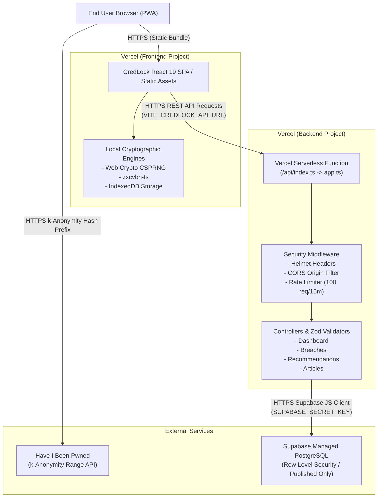

# CredLock Production Deployment Guide

This document describes the production deployment architecture, environment configurations, and verification procedures for **CredLock** (PWA Frontend) and **CredLock Security Intelligence API** (Express.js Backend) on **Vercel** with **Supabase Managed PostgreSQL**.

---

## 1. Deployment Topology



---

## 2. Production Service Endpoints

| Component | Platform | Production URL | Notes |
|---|---|---|---|
| **Backend API** | Vercel Serverless | `https://credlock-api.vercel.app` | Express 5 application running as a Vercel Serverless Function via rewrites. |
| **API Health Liveness** | Vercel Serverless | `https://credlock-api.vercel.app/api/health` | HTTP 200 basic liveness probe (independent of database state). |
| **Database Readiness** | Vercel Serverless | `https://credlock-api.vercel.app/api/health/db` | HTTP 200 readiness probe with connectivity status and latency metrics. |
| **Frontend PWA** | Vercel Web Service | Verified Vercel Project Deployment | Static Single Page Application built with Vite. |
| **Breach Lookup** | Have I Been Pwned | `https://api.pwnedpasswords.com/range` | Privacy-preserving k-anonymity API queried directly from client browser. |

---

## 3. Environment Variables Configuration

### A. Frontend Project Settings (Vercel)

Set these environment variables in your Vercel Project Settings under **Settings > Environment Variables**:

| Variable | Required | Production Value | Description |
|---|:---:|---|---|
| `VITE_CREDLOCK_API_URL` | **Yes** | `https://credlock-api.vercel.app` | Base URL of the deployed CredLock Security Intelligence API. |
| `VITE_APP_ENV` | Optional | `production` | Active runtime environment indicator. |

> [!IMPORTANT]
> - Never store Supabase Secret Keys or sensitive tokens in the frontend project settings.
> - Only variables prefixed with `VITE_` are embedded into the client bundle at build time.

### B. Backend Project Settings (Vercel)

Set these environment variables in the backend Vercel project settings:

| Variable | Required | Production Value | Description |
|---|:---:|---|---|
| `NODE_ENV` | **Yes** | `production` | Enables production optimizations and disables verbose debug logs. |
| `FRONTEND_URL` | **Yes** | `https://<your-frontend-domain>.vercel.app` | Whitelist origin for CORS. Multiple URLs can be supplied separated by commas (e.g. `https://credlock.vercel.app,http://localhost:5173`). |
| `SUPABASE_URL` | **Yes** | `https://your-project.supabase.co` | Your Supabase project URL endpoint. |
| `SUPABASE_SECRET_KEY` | **Yes** | `sb_secret_...` | Privileged server-side service role key for database queries. Bypasses RLS safely because queries enforce explicit `is_published = true` filters. |

---

## 4. Backend Vercel Serverless Configuration

The backend is configured for Vercel deployment through two key files in `backend/credlock-api/`:

1. **Serverless Entry Point (`backend/credlock-api/api/index.ts`)**:
   ```typescript
   import app from '../src/index.js';
   export default app;
   ```
2. **Rewrite Routing (`backend/credlock-api/vercel.json`)**:
   ```json
   {
     "version": 2,
     "rewrites": [
       {
         "source": "/(.*)",
         "destination": "/api"
       }
     ]
   }
   ```
3. **Build Command & Settings**:
   - **Root Directory**: `backend/credlock-api`
   - **Build Command**: `npm run build` (`tsc -p tsconfig.json`)
   - **Install Command**: `npm install --include=dev`

---

## 5. Redeployment Instructions

### Triggering a New Deployment via Git
1. Ensure all local tests and typechecks pass:
   ```bash
   npm run typecheck --prefix backend/credlock-api
   npm test --prefix backend/credlock-api
   npm test
   ```
2. Commit your changes and push to your GitHub repository:
   ```bash
   git add .
   git commit -m "chore: prepare production release"
   git push origin main
   ```
3. Vercel automatically detects the push and initiates a new deployment pipeline for both configured projects.

### Manual Redeployment in Vercel Dashboard
1. Open the [Vercel Dashboard](https://vercel.com/dashboard).
2. Select your project (`credlock` or `credlock-api`).
3. Navigate to the **Deployments** tab.
4. Click the three-dot menu `(...)` on the latest deployment and select **Redeploy**.

---

## 6. Post-Deployment Verification Checklist

Execute these checks after every production deployment:

- [ ] **Liveness Check**:
  ```bash
  curl -i https://credlock-api.vercel.app/api/health
  ```
  *Expected Output:* HTTP 200 OK with `{"success": true, "message": "CredLock API is running", ...}`.
- [ ] **Database Readiness Check**:
  ```bash
  curl -i https://credlock-api.vercel.app/api/health/db
  ```
  *Expected Output:* HTTP 200 OK with `{"success": true, "database": {"status": "connected", ...}}`.
- [ ] **CORS Verification**:
  ```bash
  curl -i -X OPTIONS https://credlock-api.vercel.app/api/v1/dashboard/summary \
    -H "Origin: https://credlock.vercel.app" \
    -H "Access-Control-Request-Method: GET"
  ```
  *Expected Output:* HTTP 204 or 200 with header `Access-Control-Allow-Origin: https://credlock.vercel.app`.
- [ ] **Security Headers Verification**:
  Ensure Helmet headers are returned:
  - `X-Content-Type-Options: nosniff`
  - `X-Frame-Options: SAMEORIGIN`
  - `Cross-Origin-Resource-Policy: cross-origin`
- [ ] **Rate Limiting Check**:
  Verify headers `ratelimit-limit`, `ratelimit-remaining`, and `ratelimit-reset` are present on `/api/v1/*` endpoints.
- [ ] **Frontend End-to-End Test**:
  1. Open the frontend in a modern web browser.
  2. Verify Dashboard KPIs populate with live threat telemetry.
  3. Navigate to **Breach Intelligence** (`/breaches`) and verify incident cards load.
  4. Navigate to **Recommendations** (`/recommendations`) and open a playbook.
  5. Navigate to **Articles** (`/articles`) and read an advisory.
  6. Execute a client-side password analysis on `/analyzer`.
  7. Generate a secure password on `/generator`.
  8. Check password against HIBP k-anonymity on `/breach-checker`.
