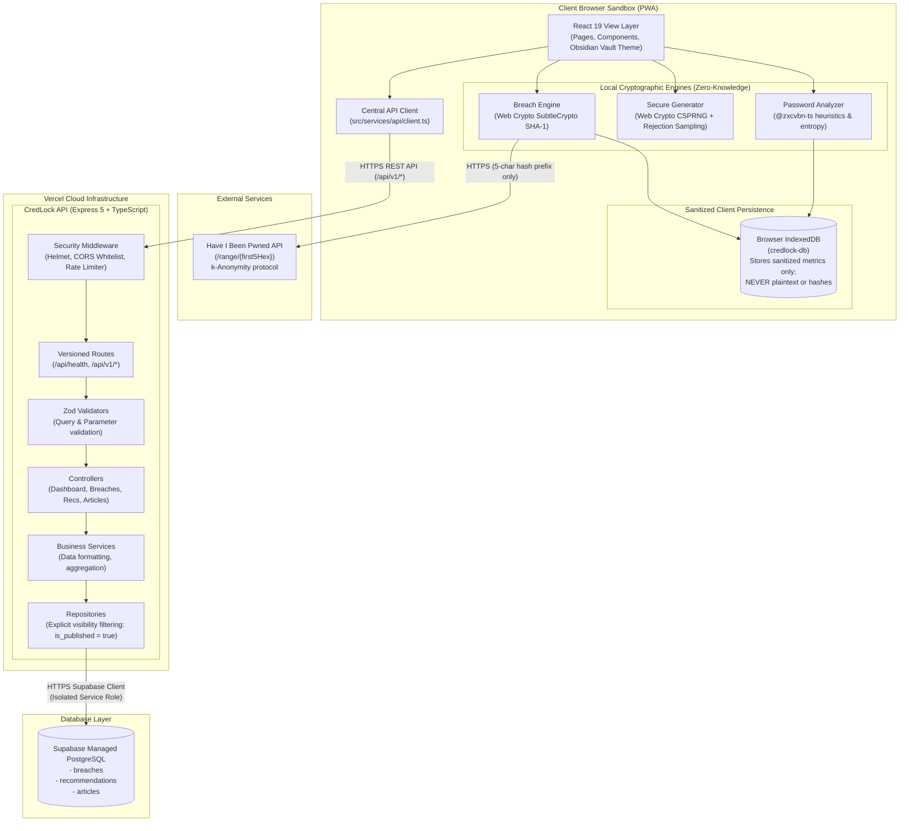

# CredLock System Architecture

This document outlines the system topology, component architecture, data flow, and directory structure of **CredLock**.

---

## 1. High-Level System Architecture

CredLock is designed around a **Client-Side Zero-Knowledge Invariant** for credential handling, combined with an isolated **Security Intelligence REST API** for threat intelligence.



---

## 2. Core Architectural Principles

### 1. Client-Side Zero-Knowledge Credential Handling
- **No Plaintext Wire Transmission:** User passwords are analyzed, scored, and generated entirely within the client's browser JavaScript runtime.
- **No Plaintext Storage:** Neither plaintext passwords, complete SHA-1 hashes, nor prefix/suffix combinations are ever written to `localStorage`, `sessionStorage`, `IndexedDB`, cookies, or remote logs.
- **Sanitized Metadata Persistence:** When users elect to save an analysis or breach check to history, only sanitized metrics (record UUID, timestamp, score, password length, theoretical entropy, and breach occurrence count) are committed to IndexedDB (`credlock-db`).

### 2. CSPRNG Password Generation with Rejection Sampling
- Password generation strictly utilizes `crypto.getRandomValues()` (Web Crypto API).
- Employs **candidate-level rejection sampling** to ensure that every generated password adheres strictly to enabled character sets without introducing modulo bias or altering the uniform probability distribution.
- Includes a hard retry limit (`MAX_GENERATOR_ATTEMPTS = 1000`) to guarantee deterministic termination.

### 3. k-Anonymity Breach Detection
- Evaluates compromised passwords against the Have I Been Pwned (HIBP) database via SHA-1 hashing.
- Only the first 5 hexadecimal characters of the hash are transmitted over the network (`https://api.pwnedpasswords.com/range/{prefix}`).
- Suffix matching occurs entirely in client RAM.

### 4. Layered Backend Security Intelligence Service
- Express 5 + TypeScript architecture with strict separation of concerns:
  - **Routes (`src/routes/`)**: Per-resource routing definitions.
  - **Validators (`src/validators/`)**: Zod schema validation for query strings and route parameters.
  - **Controllers (`src/controllers/`)**: HTTP request decoding, error handling, and JSON envelope dispatch.
  - **Services (`src/services/`)**: Business computation, data shaping, and metric aggregation.
  - **Repositories (`src/repositories/`)**: Supabase queries with strict, immutable visibility filters (`is_published = true`, `is_verified = true`).

---

## 3. Directory Structure

```text
CredLock/
├── .env.example                     # Frontend environment template
├── package.json                     # Frontend dependencies and npm scripts
├── tsconfig.json                    # Frontend TypeScript configuration
├── vite.config.ts                   # Vite bundler & chunking configuration
├── public/                          # Static assets (favicons, manifest)
│   └── favicon.svg
├── docs/                            # Comprehensive project documentation
│   ├── ARCHITECTURE.md              # System architecture & topology (this document)
│   ├── DEPLOYMENT.md                # Vercel & Supabase deployment guide
│   ├── SECURITY.md                  # Security controls & threat model
│   └── API.md                       # Complete REST API specification
├── src/                             # Frontend source code (React 19 + TypeScript)
│   ├── app/                         # App entry, layout wrappers, and router setup
│   ├── components/                  # Shared UI & design system components
│   │   ├── layout/                  # PageHeader, BottomNav, Container
│   │   └── ui/                      # Button, Card, Badge, Input, Meter, Tooltip, Toast
│   ├── context/                     # Application state contexts (ToastContext)
│   ├── hooks/                       # Custom React hooks (useHistory, useOnlineStatus)
│   ├── pages/                       # Application route pages
│   │   ├── HomePage.tsx             # Dashboard & Security Center
│   │   ├── AnalyzerPage.tsx         # Password Strength Analyzer
│   │   ├── GeneratorPage.tsx        # Secure Password Generator
│   │   ├── BreachCheckerPage.tsx    # k-Anonymity Breach Checker
│   │   ├── BreachesPage.tsx         # Breach Intelligence Catalog
│   │   ├── BreachIncidentDetailPage.tsx # Incident Detail View
│   │   ├── RecommendationsPage.tsx  # Hardening Guidance Catalog
│   │   ├── RecommendationDetailPage.tsx # Playbook Detail View
│   │   ├── ArticlesPage.tsx         # Cybersecurity Research Advisories
│   │   ├── ArticleDetailPage.tsx    # Advisory Detail View
│   │   ├── AnalysisHistoryPage.tsx  # Sanitized Analysis Audit Log
│   │   ├── AnalysisDetailPage.tsx   # Detailed Analysis Inspector
│   │   ├── BreachHistoryPage.tsx    # Sanitized Breach Query History
│   │   ├── BreachDetailPage.tsx     # Breach Check Inspector
│   │   ├── ProfilePage.tsx          # System information & privacy controls
│   │   └── NotFoundPage.tsx         # 404 Route Handler
│   ├── services/                    # Client services
│   │   ├── api/                     # Centralized API communication layer
│   │   │   ├── client.ts            # Type-safe fetch client with timeouts & error mapping
│   │   │   ├── config.ts            # API URL resolution & normalization
│   │   │   ├── dashboardService.ts  # Summary telemetry client
│   │   │   ├── breachService.ts     # Breach intelligence client
│   │   │   ├── recommendationService.ts # Playbooks client
│   │   │   ├── articleService.ts    # Articles client
│   │   │   ├── errors.ts            # Standardized ApiClientError classes
│   │   │   └── types.ts             # API envelope & pagination contracts
│   │   ├── breachChecker.ts         # SHA-1 k-Anonymity engine
│   │   ├── passwordAnalyzer.ts      # zxcvbn password heuristics wrapper
│   │   ├── passwordGenerator.ts     # Web Crypto CSPRNG generator engine
│   │   ├── historyStorage.ts        # Sanitized audit storage operations
│   │   └── db.ts                    # IndexedDB low-level connection
│   ├── styles/                      # Tailwind CSS root stylesheet
│   └── types/                       # Shared frontend TypeScript interfaces
├── tests/                           # Frontend automated test suites (node:test)
│
└── backend/credlock-api/            # Express.js + TypeScript Backend Service
    ├── .env.example                 # Backend environment variable template
    ├── package.json                 # Backend dependencies and npm scripts
    ├── tsconfig.json                # Backend TypeScript configuration (NodeNext ESM)
    ├── vercel.json                  # Vercel serverless rewrite rules
    ├── api/                         # Vercel serverless function entry point
    │   └── index.ts                 # Handler exporting Express app
    ├── database/                    # Supabase SQL schema migrations and seed scripts
    │   ├── 001_create_credlock_tables.sql
    │   ├── 002_seed_credlock_data.sql
    │   └── README.md
    ├── src/                         # Backend source code
    │   ├── app.ts                   # Express app initialization & middleware stack
    │   ├── server.ts                # Conventional HTTP server listener for local dev
    │   ├── index.ts                 # App factory export for serverless
    │   ├── config/                  # Environment validation (env.ts) & Supabase client
    │   ├── controllers/             # HTTP controller handlers
    │   ├── middleware/              # Helmet, CORS, Rate Limit, Error & Logger middleware
    │   ├── repositories/            # Supabase database access with published-only filters
    │   ├── routes/                  # Express route definitions (/api/health, /api/v1/*)
    │   ├── services/                # Business logic & threat telemetry aggregators
    │   ├── types/                   # Backend TypeScript DTOs
    │   ├── utils/                   # JSON response envelopes & text sanitizers
    │   └── validators/              # Zod schema validators
    └── tests/                       # Backend test suites (Vitest + Supertest)
```
